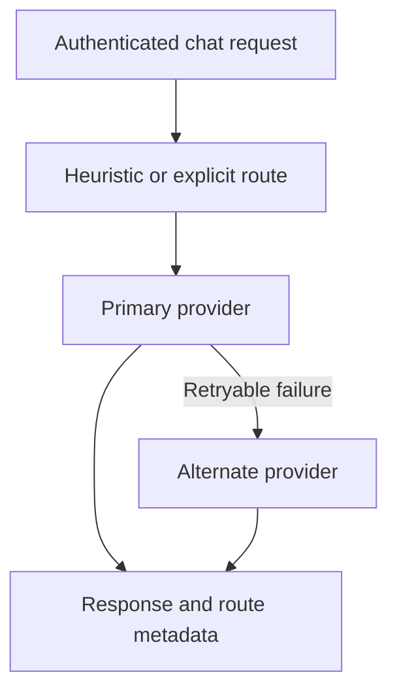

# RouteWise

**Explainable LLM routing and provider failover.** An independent Python engineering project by Neeli Yaswanth Kumar.

[Interactive routing playground](https://kyaswanthneeli-stack.github.io/projects/routewise.html) · [Portfolio](https://kyaswanthneeli-stack.github.io/)

## What works

- A non-streaming `/v1/chat/completions` endpoint using a limited OpenAI-shaped request/response schema.
- Automatic routing based on user-text length and complexity keywords, plus explicit `fast`/`reasoning` overrides.
- At most two sequential provider attempts: fallback on 429, server errors, network failures or timeout.
- Server-only provider configuration, bearer authentication, 15-second per-attempt timeouts and no redirects.
- A bounded authenticated route/latency history without raw prompt logging.
- A clearly labeled no-key demo mode and a Dockerfile for backend hosting.

This version uses **deterministic heuristics, not semantic embeddings or a trained encoder**. It has no cache, streaming, tool calls, circuit breaker, quality guarantee or measured cost-savings claim. It is not fully compatible with every OpenAI client feature.

## Run

```bash
git clone https://github.com/kyaswanthneeli-stack/routewise.git
cd routewise
python3 -m venv .venv
source .venv/bin/activate
pip install -r requirements.txt
export ROUTEWISE_API_KEY="$(python -c 'import secrets; print(secrets.token_hex(32))')"
uvicorn app:app --host 127.0.0.1 --port 8001
```

Without provider configuration the service returns a labeled fixture, not generated text. Open `http://127.0.0.1:8001/docs` for the API schema.

```bash
curl http://127.0.0.1:8001/v1/chat/completions \
 -H "Authorization: Bearer $ROUTEWISE_API_KEY" -H 'Content-Type: application/json' \
 -d '{"model":"auto","messages":[{"role":"user","content":"Analyze these architecture tradeoffs"}],"max_tokens":256}'
```

## Connect real providers

Set these **server environment variables** before starting the application. Use your provider's documented HTTPS base URL ending in `/v1`; the service appends `/chat/completions`.

| Variable | Meaning |
| --- | --- |
| `FAST_BASE_URL` | Fast provider HTTPS API base |
| `FAST_API_KEY` | Its server-side credential |
| `FAST_MODEL` | Its exact supported model ID |
| `REASONING_BASE_URL` | Second provider HTTPS API base |
| `REASONING_API_KEY` | Its server-side credential |
| `REASONING_MODEL` | Its exact supported model ID |
| `ROUTEWISE_API_KEY` | Credential your clients use to call this gateway |

One configured provider is supported, but failover requires two. A configured provider may incur charges. No credentials or provider URLs are accepted from request payloads. Authentication errors (401/403) and other non-retryable client errors produce a sanitized 502 instead of trying another provider. When both retryable attempts fail, the gateway returns 503. Timeouts can produce duplicate upstream charges if a provider completed work before the connection failed; there is no provider-wide idempotency guarantee.

## Request walkthrough

1. Authenticate the bearer token and validate bounded messages and output-token limit.
2. Classify combined user-message text. More than 600 characters or a listed complexity keyword selects `reasoning`.
3. Apply an explicit route override if requested.
4. Call the selected configured provider and fall back only for retryable failures.
5. Return the provider's answer with `routing` metadata showing attempts, selection, elapsed latency and demo status.
6. Read `/metrics` with the same bearer token for the last 200 successful requests. Failures are not currently retained.



## Tests

```bash
python -m unittest -v
```

14 tests exercise authentication, classification, overrides, demo labeling, stream rejection, mocked rate limits and timeouts, non-retryable errors, malformed upstream responses, total outage and prompt-free metrics. Live provider credentials were not used in these tests.

## Honest measurement and deployment

No under-15ms classifier benchmark is claimed. End-to-end latency is measured per request and includes provider attempts. Costs are unknown by default (`null`); the Python `Provider` object permits explicit per-million input/output prices for an estimate based on returned usage. No current prices or savings percentages are embedded.

The public `docs/index.html` playground simulates provider outcomes entirely in the browser. It never calls a model. The Python API requires a separate backend host; GitHub Pages serves static assets only. The Dockerfile uses an unprivileged user. Supply environment variables through your host's secret settings and add TLS, ingress rate limiting, persistent monitoring and operational controls before wider deployment. Metrics are memory-only and reset on restart. Heuristic misrouting and fallback quality regression are expected limitations.

Next steps: evaluated semantic classifier, held-out quality/cost dataset, provider-specific token limits, streaming, durable observability and admission control.

## Engineering verification and deployment

[](https://github.com/kyaswanthneeli-stack/routewise/actions/workflows/ci.yml)

- [Architecture diagram, five-minute walkthrough and hosting checklist](docs/ARCHITECTURE_AND_DEMO.md)
- [GitHub Actions tests and Docker build results](https://github.com/kyaswanthneeli-stack/routewise/actions/workflows/ci.yml)
- [Railway deployment configuration](railway.json) with Docker and `/health`.

**Hosting status:** deployment *configured*, not a claimed live production API. A hosting service and an authenticated server-side `ROUTEWISE_API_KEY` are required. With no provider credentials, responses are explicitly labeled mock demonstrations. Never publish a live upstream key in client-side code.

## Captioned architecture video

[Download the 20-second MP4 architecture explainer from the latest successful Actions run](https://github.com/kyaswanthneeli-stack/routewise/actions/workflows/walkthrough.yml). The source-of-truth render script is [docs/build_walkthrough.py](docs/build_walkthrough.py). The video is **captioned and silent** and explains the code architecture; it is **not** a recording of a live external API or paid model. Use the demo instructions above to show real backend behavior.
