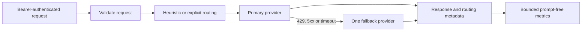

# LLM request routing gateway: architecture and demo

## Architecture

## Recruiter walkthrough (five minutes)

Demonstrate 401 without a bearer token, fast vs reasoning routing, explicit overrides, mocked 429/timeouts with failover, authenticated metrics and the 14 unit tests.

Run `python -m unittest -v` on the actual Python service. Show `GET /health`, `GET /docs`, and a successful authenticated example using synthetic data. If recording, use disposable keys and no private source information.

## Railway deployment

1. Connect this exact GitHub repository to a Railway service. The checked-in `railway.json` selects its Dockerfile and `/health` check.
2. Assign the host the listening service port 8000; set `PORT=8000` if required by your Railway networking configuration.
3. Set ROUTEWISE_API_KEY as a host secret. To invoke real models configure FAST_BASE_URL, FAST_API_KEY, FAST_MODEL, REASONING_BASE_URL, REASONING_API_KEY and REASONING_MODEL on the server only.
4. Attach a public HTTPS domain, wait for a passing health check, and test with `curl https://YOUR_HOST/health`.
5. Set hosting ingress limits and observability before sharing broadly. Never include secrets in GitHub Pages or a demo video.

## Accurate scope and limitations

Browser demo and no-provider API responses are explicitly synthetic. Classifier is heuristic, not semantic. No verified LLM quality or cost savings.
